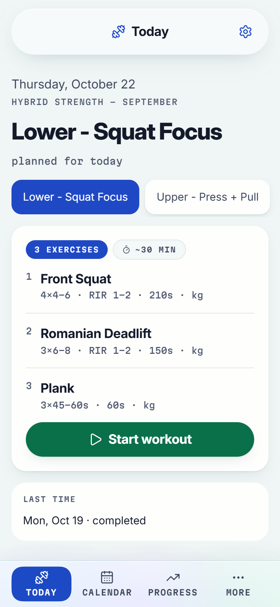
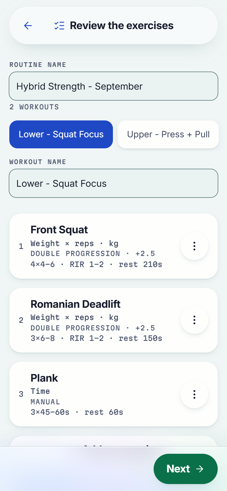
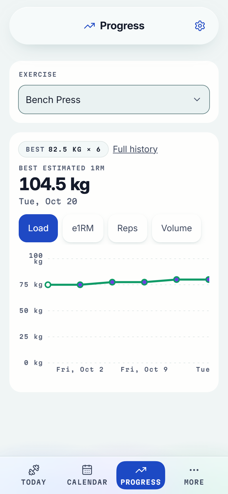
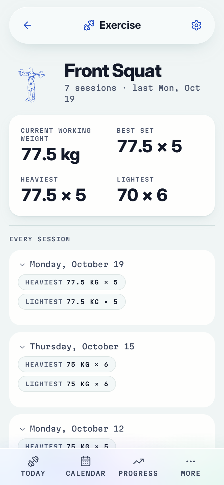

# TrainLog

An offline-first training PWA. You write your programme as a YAML file; the app
runs it in the gym, records what you actually did, and works out your next load
from that record.

Built for one situation: a phone, in a gym, with unreliable signal. No account,
no server, no subscription — your data lives in your browser and leaves only when
you export it.

**[Try it live](https://trainlog.josuee152.workers.dev/)** — open it on your phone and tap *Try an example routine*.

<p align="center">
  
  
  
  
</p>

## The idea

Two things are kept strictly apart:

**Planned** — what the programme said. `Front Squat, 4 × 4-6, RIR 1-2, rest 3:30`

**Actual** — what you did. `75 × 6 @2, 75 × 6 @2, 75 × 5 @1, 75 × 5 @1`

Every other feature falls out of that separation. History is a record of the
actual, never rewritten when a programme changes. Progression is calculated from
the actual, not tracked as a number someone has to maintain. And when you edit a
routine, last month's sessions still say exactly what last month asked of you.

Workouts carry no dates. You import a routine, assign its workouts to days, and
then move them around as real life happens — skipping Monday and squatting on
Tuesday is not an exception the app has to handle, it is just how it works.

## Your routine, as a file

```yaml
version: 2

routine:
  name: "Hybrid Strength - September"
  weeks: 4

  workouts:
    - name: "Push - Quad + Shoulder Strength"
      suggested_days: [monday, friday]

      exercises:
        - name: "Front Squat"
          category: "quadriceps"
          sets: 4
          reps: { min: 4, max: 6 }
          rir:  { min: 1, max: 2 }
          rest_seconds: 210

          progression:
            type: "double_progression"
            increment: 2.5

        - name: "Plank"
          measurement: "duration"
          sets: 3
          target: { min: 45, max: 60 }   # seconds, no rep range
          rest_seconds: 60
          progression:
            type: "manual"
```

Import it, review it, confirm the days, train. Version `1` files still load,
read by the same rules. Version `2` is the one that added `measurement`, so an
exercise can be measured in reps, time, distance, added or assisted bodyweight,
or a pair of those, and states its target on whichever axis it is scored on.

You do not have to write the file by hand: routines can also be created and
edited inside the app. Every field, the nine measurement types and every
validation rule are described in [docs/FORMAT.md](./docs/FORMAT.md).

## What it does

Routine import with a review step · routine authoring and editing in-app ·
calendar you control, with placements you can move to any day · workout execution
with weight, reps, RIR, duration and distance · rest timer that survives a locked
phone · stopwatch for timed sets, so holds and intervals (HIIT as a Workout) need
no other app · previous performance shown when you need it · nine measurement types ·
bodyweight as a setting, recorded onto the sessions that need it · exercise
catalog shipped in the build · per-exercise history and session detail ·
estimated 1RM and personal records · progress dashboard, with an exercise compared
across the routines it was trained in and this week's sets per muscle, planned
against logged · double progression · session effort · your own exercises
created, renamed (the old name keeps matching on import) and deleted when unused
· full backup through the phone's share sheet, optionally password-encrypted,
with a reminder after training, plus restore and CSV export · a warning on Today
when the browser may clear your data · installable, and fully usable offline.

Live demo: <https://trainlog.josuee152.workers.dev/>. It deploys automatically from `master` through
Cloudflare's Git integration; no workflow in this repo does it.

## Known limits

- Session history lives in the Calendar: tap a day to see its sessions. There is
  no separate list of past sessions.
- There is no way to delete a single session or to clear all data from inside the
  app. Restoring a backup replaces everything.
- Catalog exercises cannot be renamed or deleted; only exercises you created can.
- Two devices cannot be kept in sync: a backup restored on another device
  replaces what is there.

Deliberately out of scope: accounts, cloud sync, social features, nutrition,
wearables, and AI coaching.

## Running it

```bash
pnpm install
pnpm dev
```

| Command | What it does |
| --- | --- |
| `pnpm dev` | Dev server (`pnpm dev:phone` serves over HTTPS for a phone on the LAN) |
| `pnpm test` | Vitest, with `fake-indexeddb` |
| `pnpm typecheck` | `tsc --noEmit` over the app and node configs |
| `pnpm lint` | ESLint |
| `pnpm build` | Static build into `dist/` |

## Documentation

| Document | What it holds |
| --- | --- |
| [docs/FORMAT.md](./docs/FORMAT.md) | The routine file format, field by field |
| [CONTRIBUTING.md](./CONTRIBUTING.md) | Setup, checks, rules and how to open a pull request |
| [docs/PRD.md](./docs/PRD.md) | The full product specification (in Spanish) |
| [PRODUCT.md](./PRODUCT.md) | Product purpose, users, and the committed stack |
| [DESIGN.md](./DESIGN.md) | The visual system |
| [CONTEXT.md](./CONTEXT.md) | Glossary — the words this project uses, and the ones it avoids |
| [docs/adr/](./docs/adr/) | Architectural decisions and why they were made |
| [docs/changes/](./docs/changes/) | One folder per change: spec, plan, execution, verification |
| [AGENTS.MD](./AGENTS.MD) | Rules for working in this repository |

## Stack

React · TypeScript · Vite · React Router · Tailwind CSS · Radix · Dexie over
IndexedDB · Zod · Recharts · vite-plugin-pwa · Vitest. Layering is one-way:
`features → db → domain`. Deploys as static files to any host.

## Credits

The exercise catalog in [`src/domain/catalog/data.ts`](./src/domain/catalog/data.ts)
and the figures in [`public/exercise-art/`](./public/exercise-art) both come from
[Workout Guide](https://github.com/bryllim/workout-guide) by Bryl Lim. The
package is not a dependency: the movement rows were copied at build time and
remapped to this project's vocabulary, and one frame of each drawing was
optimized into the files this app ships.

The two halves carry different licences, and the second one binds this project:

- Movement metadata — **MIT**.
- Exercise figures, and the Everkinetic artwork they derive from — **CC BY-SA
  4.0**. The credit that licence requires is shown in the app on the More
  screen, and the drawings stay under CC BY-SA 4.0 wherever they are
  redistributed from here.
