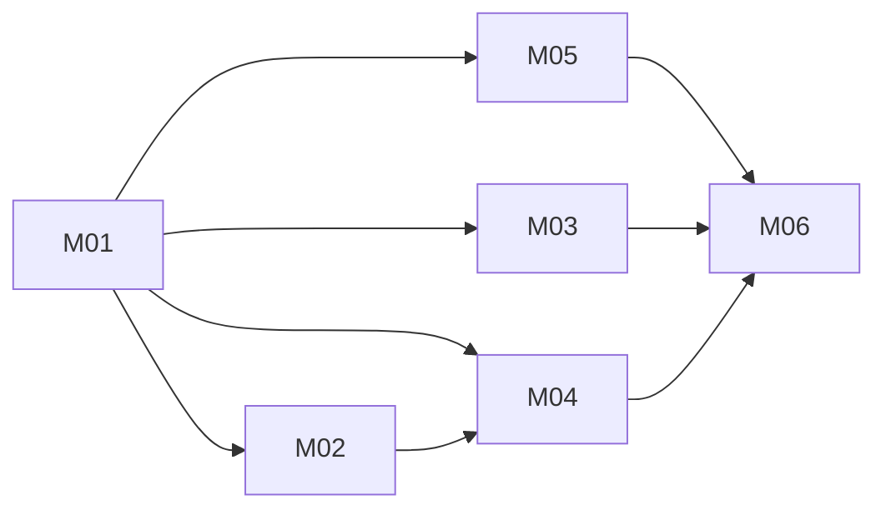

# TrainLog Build Plan

Baseline: RV-001
Change folders: docs/changes/. Milestone folders are named YYYY-MM-DD-Mxx-<slug>.

Milestone status. No status is stored in this plan:

```bash
grep -iH -m4 -E '^(Verdict|Acceptance|Verified by|Open limitations):' docs/changes/*-[Mm][0-9]*-*/verification.md
```

## Strategy

This is a retroactive package, so every MVP behaviour already exists in `src/`. Each
milestone is a conformance slice. It takes one end-to-end journey and maps each
requirement to an acceptance condition. Where existing tests prove the condition, it
records them. Where they do not, it adds a focused test, plus on-device evidence when
a browser property cannot be simulated. Code changes only when a test exposes code
that differs from the package. That is a new drift, and it stops the milestone (see
"Stop if").

The riskiest assumption is ADR-001's: the installed app works offline and the
browser keeps its data. M01 tests it on real phones before any other slice.

## Architecture Proof Slice

Milestone: M01

Why this is the smallest useful end-to-end proof:

- It crosses every container: SPA, service worker, IndexedDB and static host. It
  also crosses every layer rule (AR-001 to AR-003).
- It covers the core journey offline: import, train, lock the phone, resume and
  finish. It covers the durability properties NFR-001 and NFR-003 to NFR-005 that
  ADR-001 and ADR-004 rest on.
- If storage is evicted or the shell fails offline on a real phone, the system
  shape itself is wrong. Every later slice would then rest on a broken assumption.

## Dependency Graph



## Milestone M01 — Offline: import a routine, train it, resume after interruption

Goal:
On an installed app in airplane mode, the lifter imports a block file, starts
Today's Workout, logs sets with the rest timer running, locks the phone, kills the
app, resumes, and finishes. Nothing is lost.

Requirements:
- FR-001, FR-002, FR-003, FR-004, FR-005, FR-006, FR-007, FR-008, FR-009, FR-010
- FR-011, FR-012, FR-013, FR-014, FR-015, FR-016
- FR-030, FR-035, FR-036, FR-049, FR-050, FR-051, FR-052, FR-053, FR-054, FR-087
- NFR-001, NFR-003, NFR-004, NFR-005, NFR-011
- BR-002, BR-003, BR-005, BR-006, BR-007, BR-020
- CON-001, CON-002, CON-003, CON-004

Canonical authorities:
- `docs/design/architecture/architecture.md`
- `docs/design/architecture/adr/ADR-001-system-shape.md`
- `docs/design/architecture/adr/ADR-003-snapshot-planned-targets-on-session-start.md`
- `docs/design/architecture/adr/ADR-004-indexeddb-via-dexie-as-the-only-store.md`
- `docs/design/data/schema.dbml`
- `docs/design/ux/flows.mmd` (J-001, J-002)
- `docs/FORMAT.md`
- `docs/design/architecture/quality-attributes.md` (AR-001 to AR-003)

Prerequisites:
- None.

Expected create/edit areas:
- The existing tests under `src/domain/routine-file/`, `src/domain/session/`,
  `src/db/repositories/` and `src/features/import/`, read and extended only where an
  AC is unproven.
- Proposed: an architecture-rule test or lint rule (`eslint.config.js`).
- Proposed: `on-device.md` in the milestone change folder.

Acceptance:
- AC-001 — A structurally invalid file never reaches the wizard. A file with a
  semantic issue from FORMAT.md loads, the issue is flagged on its field, and Accept
  stays blocked until it is fixed (FR-002, FR-003).
- AC-002 — Accept stores the Routine, Workouts, Planned Exercises, any new Exercises
  and the Placements in one transaction. The Placements cover exactly `weeks × 7`
  days from the start date (FR-012, FR-014).
- AC-003 — Starting a Session snapshots every planned exercise of the Workout. A
  later change to the Routine leaves the Session's planned values unchanged
  (FR-036, BR-002).
- AC-004 — A second Session cannot start while one is `in_progress` (FR-035).
- AC-005 — The remaining rest time is derived from the stored set timestamp. After
  two minutes with the phone locked, it is within 1 s of the true time (NFR-004).
- AC-006 — The app is killed straight after a set is confirmed. On reopen, Today
  offers to resume the Session, and the set is present (NFR-003, NFR-005).
- AC-007 — With the app installed, the first load done and the device in airplane
  mode, the whole AC-001 to AC-006 flow completes (NFR-001).
- AC-008 — On iOS and on Android, the installed app reports persisted storage after
  the Session is finished (ADR-001 verification).
- AC-009 — Every routine file in `docs/examples/` keeps importing (NFR-011).

Tests:
- TST-001 — AR-001: an import check fails when `domain/` imports `db/` or
  `features/`, when `db/` imports `features/`, or when `pwa/` imports `features/`,
  `db/` or `domain/`. The existing lint rule covers the first two; the `pwa/` rule
  is new.
- TST-002 — AR-002: a check fails when non-test `src/` code uses `fetch`,
  `XMLHttpRequest`, `WebSocket`, `EventSource` or `sendBeacon`.
- TST-003 — AR-003: a check fails when code outside `src/db/` imports `dexie`. It
  must allow `dexie-react-hooks` in `features/` if live queries stay there; the
  milestone records that choice.
- TST-004 — The existing or added tests for AC-001 to AC-004 and AC-009 are named
  in the verification record.
- TST-005 — `restRemaining` stays correct across a simulated clock jump (AC-005).
- TST-006 — On-device checklist for AC-005 to AC-008, run on one iPhone and one
  Android phone and recorded with device, OS and browser.

Quality gates:
- `pnpm typecheck`, `pnpm lint`, `pnpm test`, `pnpm build`.

Completion evidence:
- A test list mapped to AC-001 to AC-009, the new checks failing on a planted
  violation and then passing, and the on-device record.

Stop if:
- implementation requires changing a frozen product behaviour;
- canonical authorities contradict each other;
- an unapproved architecture decision is required;
- required scope expands beyond this milestone;
- AC-008 fails on either platform. ADR-001 is then in question, and a new baseline
  must open before anything else proceeds;
- fixes drift DR-008 — it is closed by documentation: FR-050 and PRD §14 state that
  pause and added time do not survive a reload. Stop if the code is found to
  differ;
- fixes drift DR-009 — FR-003 defers to the twelve checks in FORMAT.md. Stop if
  `validate.ts` and FORMAT.md disagree;
- fixes drift DR-005 — the deployment target is Workers static assets
  (architecture.md, `static-host`). Stop if `wrangler.jsonc` says otherwise.

## Milestone M02 — Deviations and progression during a Session

Goal:
During a Session, the lifter sees the previous performance and a suggestion, logs
sets in any unit, and deviates freely. The next Session suggests the right target.

Requirements:
- FR-037, FR-038, FR-039, FR-040, FR-041, FR-042, FR-043, FR-044, FR-045, FR-046
- FR-047, FR-048, FR-055, FR-056, FR-057, FR-058, FR-059
- BR-001, BR-012, BR-013, BR-014, BR-015, BR-019

Canonical authorities:
- `docs/design/domain.md` (Exercise Session, Completed Set, derived values)
- `docs/design/data/schema.dbml` (`exerciseSessions`, `completedSets`)
- `docs/design/architecture/quality-attributes.md` (AR-004, AR-005)

Prerequisites:
- M01.

Expected create/edit areas:
- The existing tests under `src/domain/progression/`, `src/domain/session/`,
  `src/domain/measurement.ts` and `src/features/session/`.

Acceptance:
- AC-010 — With double progression, an increment is suggested only when the first
  N sets of the previous eligible Session all reach the top of the range, where N
  is that Session's planned sets. Otherwise the previous load repeats
  (FR-056, FR-057).
- AC-011 — A `manual` exercise repeats the previous load. An unplanned exercise
  gets no suggestion (FR-058, FR-059).
- AC-012 — A `partial` Session counts only for exercises performed in full. An
  `in_progress` Session never counts (BR-012).
- AC-013 — A set can be logged in a unit other than the planned default. Weight is
  stored as entered and as kilograms. RIR `null` stays distinct from 0
  (FR-040, FR-041, BR-014, BR-019).
- AC-014 — Extra or fewer sets, skip, reorder, unplanned exercises, editing a set
  and deleting a set never block the lifter, and each deviation is marked
  (FR-042 to FR-048).
- AC-015 — A Session with nothing logged can be discarded (FR-055).
- AC-016 — For each of the nine measurement types, a set collects only that type's
  fields, and assisted bodyweight and pace read lower-is-better (FR-038, BR-015).

Tests:
- TST-007 — AR-004: measurement facts are defined only in
  `src/domain/measurement.ts`. A check or review records any restatement found.
- TST-008 — AR-005: rendering past history performs no Planned Exercise lookup
  (`src/domain/history.test.ts`, extended if needed).
- TST-009 — The existing or added tests for AC-010 to AC-016 are named in the
  verification record.

Quality gates:
- `pnpm typecheck`, `pnpm lint`, `pnpm test`.

Completion evidence:
- A test list mapped to AC-010 to AC-016.

Stop if:
- implementation requires changing a frozen product behaviour;
- canonical authorities contradict each other;
- an unapproved architecture decision is required;
- required scope expands beyond this milestone;
- fixes drift DR-002 — the unit belongs to the set (BR-014). Stop if any code path
  forces the unit per Exercise;
- fixes drift DR-003 — a partial Session can feed progression (BR-012). Stop if
  the code admits only `completed`.

## Milestone M03 — Routines, calendar and Today

Goal:
The lifter manages Routines, moves and deletes Placements, and Today always offers
a sensible Workout.

Requirements:
- FR-017, FR-018, FR-019, FR-020, FR-021, FR-022, FR-023, FR-024, FR-025
- FR-026, FR-027, FR-028, FR-029, FR-031, FR-032, FR-033, FR-034
- BR-004, BR-008, BR-009, BR-010, BR-011

Canonical authorities:
- `docs/design/architecture/adr/ADR-002-dateless-workouts-with-user-owned-placements.md`
- `docs/design/domain.md` (Routine lifecycle, Placement)

Prerequisites:
- M01.

Expected create/edit areas:
- The existing tests under `src/domain/scheduling/`,
  `src/db/repositories/routines.ts`, `placements.ts` and `workouts.ts`, and
  `src/features/routines/`, `calendar/` and `today/`.

Acceptance:
- AC-017 — Activating a Routine archives the other active one. Deleting a Routine
  that has Sessions is refused and archiving is offered instead
  (FR-018, FR-020, FR-021).
- AC-018 — Additions are offered only on the active Routine. Nothing stored in a
  Routine is renamed, reordered, retargeted or removed (FR-022, FR-023, BR-004).
- AC-019 — Day state follows the precedence in progress, partial, completed, then
  missed, planned or rest. An earlier Session in the same Monday-week covers one
  Placement. A past Placement never moves (FR-026, BR-009, BR-010).
- AC-020 — Moving and deleting a Placement never touches Sessions, and deleting
  needs a second confirmation (FR-027, FR-028, BR-008).
- AC-021 — Today labels its suggestion as either planned or next in rotation. It
  surfaces an open Session. With no Routine, it offers import or start from scratch
  (FR-031, FR-033, FR-034).

Tests:
- TST-010 — The existing or added tests for AC-017 to AC-021 are named in the
  verification record.
- TST-011 — Rotation order equals the file's Workout order. This is still
  unverified; the brief and PRD flag it.

Quality gates:
- `pnpm typecheck`, `pnpm lint`, `pnpm test`.

Completion evidence:
- A test list mapped to AC-017 to AC-021.

Stop if:
- implementation requires changing a frozen product behaviour;
- canonical authorities contradict each other;
- an unapproved architecture decision is required;
- required scope expands beyond this milestone;
- fixes drift DR-010 — UX-005 lists only confirmations that exist. Stop if a
  confirmation is missing for a listed action.

## Milestone M04 — Exercises, history and progress

Goal:
The lifter manages their own Exercises, reads each Exercise's history and each
Session's detail, and reads progress per Exercise and per week.

Requirements:
- FR-060, FR-061, FR-062, FR-063, FR-064, FR-065, FR-066
- FR-067, FR-068, FR-069, FR-070, FR-071, FR-072, FR-073, FR-074
- NFR-006, NFR-007
- BR-016, BR-017, BR-018

Canonical authorities:
- `docs/design/domain.md` (Exercise, derived values)
- `docs/design/data/schema.dbml` (`exercises`)

Prerequisites:
- M01 and M02, since progress reads sets of every measurement type.

Expected create/edit areas:
- The existing tests under `src/domain/catalog/`, `src/domain/history.ts`,
  `src/domain/volume.ts`, `src/domain/session-summary.ts`,
  `src/db/repositories/exercises.ts` and `src/features/progress/`.

Acceptance:
- AC-022 — A rename keeps the old name resolving on import. A name already
  answered to is refused. A delete is refused while any Session or Routine uses the
  Exercise. Catalog Exercises are read-only (FR-062 to FR-065).
- AC-023 — Estimated 1RM follows BR-017, records follow FR-072, and volume
  families never mix (BR-016).
- AC-024 — Progress offers only the metrics an Exercise's type defines (FR-070).
- AC-025 — Effort appears on Session detail when it can be computed, and it is
  never labelled load (FR-068, BR-018).
- AC-026 — On a mid-range Android phone, logging, editing and navigating complete
  in under 100 ms, and no screen scrolls sideways at 360 px or 430 px
  (NFR-006, NFR-007).

Tests:
- TST-012 — The existing or added tests for AC-022 to AC-025 are named in the
  verification record.
- TST-013 — The on-device timing and layout record for AC-026: device, method and
  the figures measured.

Quality gates:
- `pnpm typecheck`, `pnpm lint`, `pnpm test`.

Completion evidence:
- A test list mapped to AC-022 to AC-025, and the record for AC-026.

Stop if:
- implementation requires changing a frozen product behaviour;
- canonical authorities contradict each other;
- an unapproved architecture decision is required;
- required scope expands beyond this milestone.

## Milestone M05 — Backup, restore, export, settings and updates

Goal:
The lifter moves their data to a new phone, optionally encrypted, and takes their
history to a spreadsheet. Settings and updates behave as specified.

Requirements:
- FR-075, FR-076, FR-077, FR-078, FR-079, FR-080, FR-081, FR-082, FR-083, FR-084
- FR-085, FR-086, FR-088, FR-089, FR-090
- NFR-002, NFR-008, NFR-009, NFR-010
- BR-021, BR-022, BR-023

Canonical authorities:
- `docs/design/architecture/adr/ADR-005-versioned-json-backup-with-optional-password-encryption.md`
- `src/domain/backup/` (backup contract, declared in the manifest)
- `docs/design/ux/flows.mmd` (J-005)
- `docs/design/architecture/quality-attributes.md` (Threats, AR-006)

Prerequisites:
- M01.

Expected create/edit areas:
- The existing tests under `src/domain/backup/`, `src/db/repositories/backup.ts`,
  `src/db/schema.test.ts`, `src/features/settings/` and `src/pwa/`.

Acceptance:
- AC-027 — A backup from each earlier `BACKUP_VERSION` restores. A newer one is
  refused before any write (FR-081, FR-082, NFR-009).
- AC-028 — Restore validates first, saves a safety backup, warns about an open
  Session, replaces the eight training stores in one transaction, and leaves
  Settings untouched (FR-077 to FR-080, BR-021).
- AC-029 — An encrypted backup reveals nothing without its password. A wrong
  password or a tampered byte restores nothing (FR-076, NFR-008).
- AC-030 — The CSV header keeps its existing column positions, cells a type does
  not carry are empty, and formula-leading cells are neutralized
  (FR-083, NFR-010, BR-023).
- AC-031 — The backup reminder appears after a finished Session when no backup
  exists, or when the last one is 7 days old or more (FR-084).
- AC-032 — Changing a setting alters no stored training (FR-086).
- AC-033 — A new deployment shows the update prompt and never reloads on its own
  (FR-090).
- AC-034 — A full Session logs no request to any origin other than the app's own,
  as shown in the browser's network panel (NFR-002).

Tests:
- TST-014 — AR-006: a schema upgrade test exists for each Dexie version, and a
  restore test exists for each backup version.
- TST-015 — The existing or added tests for AC-027 to AC-032 are named in the
  verification record.
- TST-016 — The on-device or browser record for AC-033 and AC-034.

Quality gates:
- `pnpm typecheck`, `pnpm lint`, `pnpm test`.

Completion evidence:
- A test list mapped to AC-027 to AC-032, and the record for AC-033 and AC-034.

Stop if:
- implementation requires changing a frozen product behaviour;
- canonical authorities contradict each other;
- an unapproved architecture decision is required;
- required scope expands beyond this milestone;
- fixes drift DR-006 — the backup is at version 3 (`src/domain/backup/`). Stop if
  any document still presents another current version.

## Milestone M06 — Retire the superseded PRD

Goal:
Every `§n` reference in the repository points at the current PRD's IDs, and
`docs/PRD.md` is deleted.

Requirements:
- CON-005

Canonical authorities:
- `docs/product/prd.md`
- `docs/spec/manifest.yaml` (`superseded_documents`)

Prerequisites:
- M03, M04 and M05, so their verification records cite the new IDs.
- A decision on PD-005 (does `docs/changes/` continue?), recorded in PRD §15 with
  the user's quote.

Expected create/edit areas:
- `AGENTS.MD`, `CONTEXT.md`, `DESIGN.md`, `docs/FORMAT.md` if it applies, and the
  comments and test names in `src/` that cite `§n`. About 40 occurrences were
  counted on 2026-10-30.
- `README.MD`, `CONTRIBUTING.md` and the `docs/changes/` row, depending on PD-005.

Acceptance:
- AC-035 — `git grep "§[0-9]"` finds no reference to a section of the old PRD
  outside git history.
- AC-036 — `docs/PRD.md` no longer exists, and no link points to it.

Tests:
- TST-017 — `pnpm test` still passes after the test names are renamed.

Quality gates:
- `pnpm typecheck`, `pnpm lint`, `pnpm test`, and the package verifier.

Completion evidence:
- The grep output for AC-035 and AC-036.

Stop if:
- implementation requires changing a frozen product behaviour;
- required scope expands beyond this milestone;
- PD-005 is still Open;
- fixes drift DR-001, DR-004 and DR-007 — the stale statements in the superseded
  PRD and in PRODUCT.md. Stop if any of them survives in a live document.

## Requirement Coverage Matrix

| Requirement | Milestone(s) | Acceptance | Tests |
|---|---|---|---|
| FR-001–FR-016 | M01 | AC-001, AC-002, AC-009 | TST-004 |
| FR-017–FR-025 | M03 | AC-017, AC-018 | TST-010 |
| FR-026–FR-029 | M03 | AC-019, AC-020 | TST-010 |
| FR-030 | M01 | AC-007 | TST-006 |
| FR-031–FR-034 | M03 | AC-021 | TST-010, TST-011 |
| FR-035, FR-036 | M01 | AC-003, AC-004 | TST-004 |
| FR-037–FR-048 | M02 | AC-010, AC-013, AC-014, AC-016 | TST-009 |
| FR-049–FR-053 | M01 | AC-005 | TST-005, TST-006 |
| FR-054 | M01 | AC-006 | TST-004 |
| FR-055–FR-059 | M02 | AC-010, AC-011, AC-012, AC-015 | TST-009 |
| FR-060–FR-074 | M04 | AC-022–AC-025 | TST-012 |
| FR-075–FR-086 | M05 | AC-027–AC-032 | TST-015 |
| FR-087 | M01 | AC-007, AC-008 | TST-006 |
| FR-088–FR-090 | M05 | AC-031, AC-033 | TST-016 |
| NFR-001, NFR-003–NFR-005, NFR-011 | M01 | AC-005–AC-009 | TST-005, TST-006 |
| NFR-002, NFR-008–NFR-010 | M05 | AC-029, AC-030, AC-034 | TST-015, TST-016 |
| NFR-006, NFR-007 | M04 | AC-026 | TST-013 |
| AR-001–AR-003 | M01 | — | TST-001–TST-003 |
| AR-004, AR-005 | M02 | — | TST-007, TST-008 |
| AR-006 | M05 | — | TST-014 |
| CON-005 | M06 | AC-035, AC-036 | TST-017 |

## Deferred Scope

- Everything in PRD §14. Each item needs a §15 decision and a new baseline before
  it is planned.
- Independent follow-up verification of review findings F-001 to F-006. Their
  status in the ledger is `READY_FOR_VERIFICATION`.
