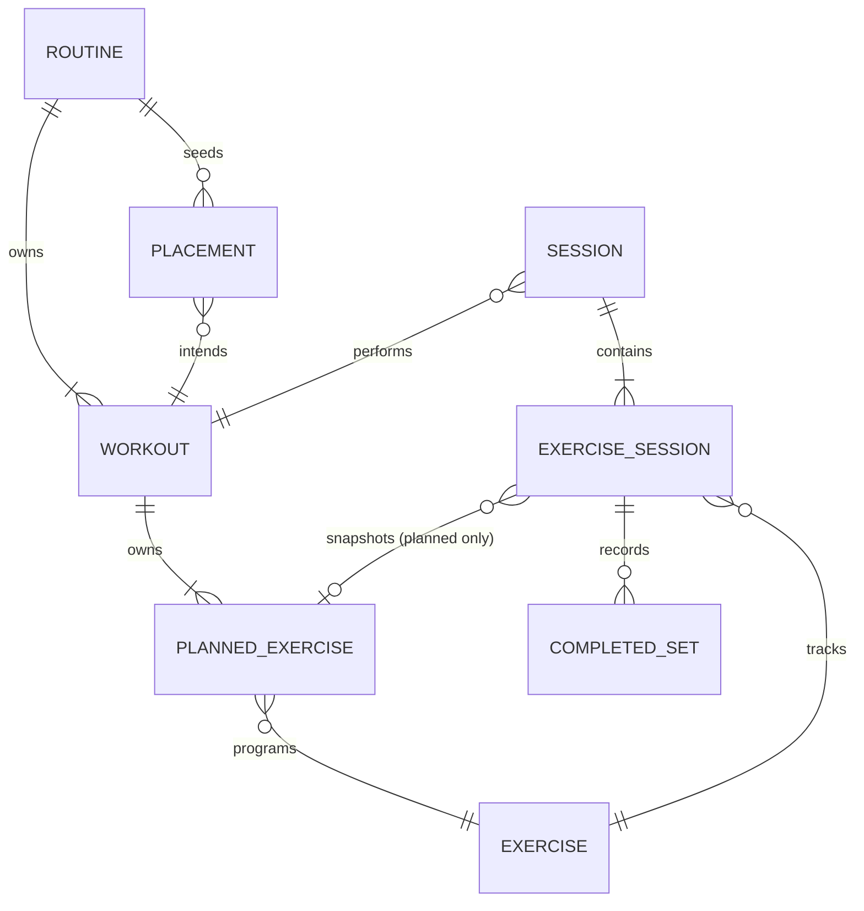
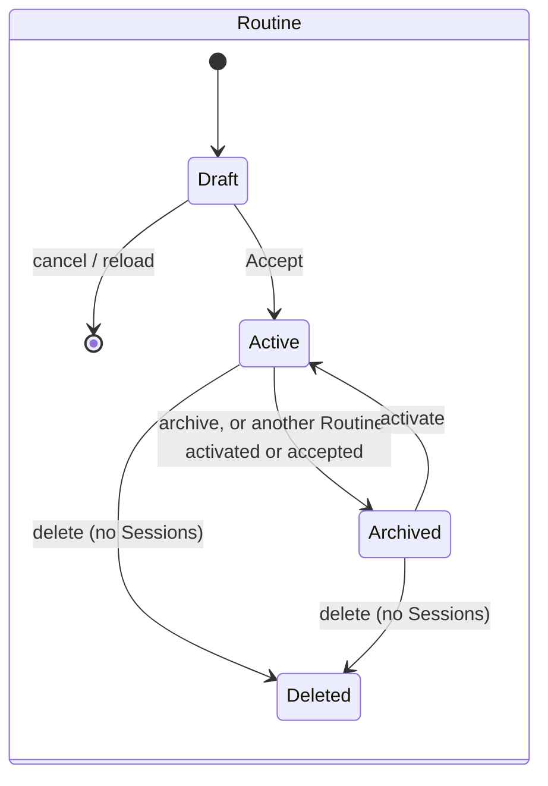
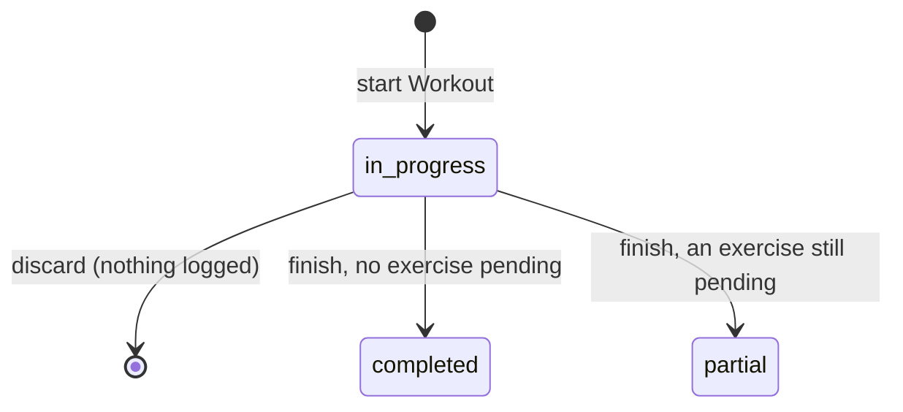

# Domain Model — TrainLog

[CONTEXT.md](../../CONTEXT.md) is the glossary and owns each term's wording. This
document owns how the concepts relate, their lifecycles and their invariants.

## Ubiquitous Language

| Term | Role in the model | Related Requirements |
|---|---|---|
| Routine / Routine Draft | Programme aggregate / its unsaved form in the wizard | FR-001–FR-025, BR-003, BR-004 |
| Workout, Suggested Day | Reusable unit of programming; advisory weekday | FR-010, FR-022, BR-011 |
| Planned Exercise, Progression Rule | One programmed exercise and how its load advances | FR-004, FR-056–FR-058 |
| Exercise, Catalog | The movement that history is keyed to; the shipped set | FR-014, FR-060–FR-066, BR-006, BR-007 |
| Placement, Missed | Intent to train a Workout on a date; derived absence | FR-026–FR-028, BR-008–BR-010 |
| Session, Exercise Session, Completed Set | What was performed | FR-035–FR-055, BR-020 |
| Snapshot, Deviation, Unplanned Exercise | How planned meets actual | FR-036, FR-044–FR-048, BR-001, BR-002 |
| Measurement, Unit, Distance Unit | What a set records and how it is compared | FR-038–FR-040, BR-014, BR-015 |
| Effort | Derived, unitless effort index of a Session | FR-068, BR-018 |
| Settings | Device defaults | FR-085, FR-086, BR-021 |

## Actors / Roles

- Lifter: the only actor. They own every Routine, Placement, Session and user
  Exercise on the device. There are no roles or permissions (NG-001, NG-002).

## Core Concepts

### Routine

- Meaning: one training programme, built from a file or from scratch.
- Identity: a generated id. Two imports of the same file are two Routines (BR-003).
- Lifecycle: see State Transitions.
- Invariants: once accepted, it takes additions only, and only while it is active
  (BR-004). At most one Routine is active at a time (FR-018). A Routine that any
  Session references is never deleted (FR-021).

### Routine Draft

- Meaning: the editable programme inside the wizard. All correction verbs (edit,
  remove, reorder, rename, replace) act here (FR-004–FR-007).
- Identity: none. It is not stored, and a reload discards it (FR-016).
- Invariants: Accept is possible only when it has no structural error and no
  semantic issue from `docs/FORMAT.md` (FR-002, FR-003). New exercise names become
  Exercises only within the Accept transaction (FR-008).

### Workout and Planned Exercise

- Meaning: a Workout is a named template with no date. A Planned Exercise holds
  sets, the target range, the RIR range, rest, unit, notes and a Progression Rule.
- Identity: generated ids, owned by their Routine.
- Invariants: Suggested Days are read only when the Workout enters a Routine
  (BR-011). A Planned Exercise points at an Exercise. History never reads targets
  back from it (BR-002).

### Exercise

- Meaning: the movement. All history and progression are keyed here (BR-006).
- Identity: a stable slug for catalog entries; a generated id for user entries.
  The name is a label (BR-007).
- Lifecycle: catalog Exercises are immutable (FR-065). User Exercises are created,
  renamed (the old name is kept in `previousNames`) and deleted only when unused
  (FR-061–FR-064).
- Invariants:
  - No two Exercises answer to the same normalized name, current or previous (FR-063).
  - The measurement type changes only while no set is logged (FR-066).
  - Import resolution order is: catalog id, then normalized name (current, then
    previous), then a new user Exercise (FR-014).

### Placement

- Meaning: the lifter's intent to train one Workout on one date.
- Identity: a generated id.
- Invariants:
  - It is independent of Sessions; neither references the other (BR-008).
  - Missed is computed, never stored (BR-009).
  - A past Placement is never shifted (BR-010).

### Session

- Meaning: one performed training of one Workout.
- Identity: a generated id. It records its Workout and Routine, and its start and
  completion times.
- Invariants:
  - At most one Session is `in_progress` (FR-035).
  - The status at finish is derived from its Exercise Sessions (FR-054).
  - A Session with nothing logged may be discarded (FR-055).

### Exercise Session

- Meaning: one exercise as performed within a Session. It is planned (with a
  Snapshot) or unplanned.
- Invariants:
  - It is created with its Snapshot and measurement type. Planned ones are created
    when the Session starts, and unplanned ones when they are added (BR-002, BR-015).
  - Substitution is a skipped planned Exercise Session plus an unplanned one.
  - Its order within the Session is the lifter's (FR-046).

### Completed Set

- Meaning: the atomic unit of history.
- Invariants:
  - The fields it carries are those its measurement type collects. The set has no
    type discriminator of its own (BR-015).
  - Weight keeps its entered value and unit, plus a derived kilogram value.
    Distance keeps its entered value and unit, plus a derived metre value (BR-014).
  - An RIR of `null` means not recorded, which is not 0 (BR-019).

### Settings

- Meaning: a single row of device defaults.
- Invariants: no setting changes stored training (FR-086). A backup carries
  Settings, but a restore never applies them (BR-021).

### Derived values (computed, never stored)

The values derived from history are:

- the progression suggestion (BR-012, BR-013);
- Missed (BR-009);
- the next Workout in rotation (FR-030);
- estimated 1RM and records (BR-017, FR-072);
- volume per family (BR-016);
- Effort (BR-018);
- weekly sets per muscle (FR-074);
- whether a backup is due (FR-084).

## Relationships and Ownership

Placement and Session never reference each other (BR-008). The link from an
Exercise Session to its Planned Exercise records where its Snapshot came from.
History reads the Snapshot, never the Planned Exercise (BR-002).

## State Transitions

Exercise Session: `pending → performed | skipped`. Finishing a Session freezes
whatever states its Exercise Sessions hold at that moment.

## Domain Boundaries / Modules

These are modules inside one bounded context. The product is too small for more
than one context.

- Programming (`routine-file`, `catalog`): the routine file format, validation,
  the Draft and its editing verbs, Exercise resolution, and the Catalog.
- Scheduling (`scheduling`): Placement generation, next-in-rotation, Missed, and
  day state.
- Execution (`session`): Session and Exercise Session transitions, Snapshot,
  status derivation, and the rest and stopwatch clocks.
- Measurement (`measurement`, `units`): which fields each type collects, axis and
  direction, and unit conversion. It is the single owner of these facts.
- Progression and history (`progression`, `history`, `volume`,
  `session-summary`): every value derived from performed sets.
- Portability (`backup`): the backup document and its validation, encryption,
  CSV, and whether a backup is due.

## Cross-Boundary Rules

- Every domain module is pure. None reads storage or renders UI, so each can be
  tested on data alone.
- Measurement facts are stated only in the Measurement module. Other modules ask it.
- Progression reads history by Exercise, never by Planned Exercise (BR-006).
- Portability depends on every other module's data, and no module depends on
  Portability.
